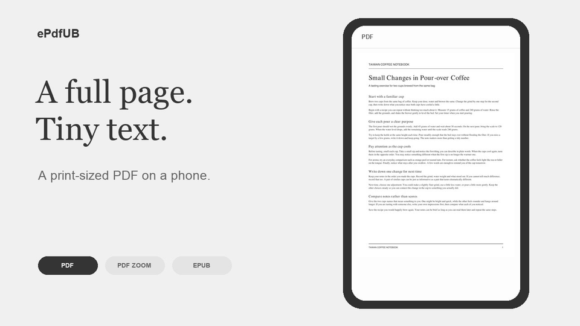

# ePdfUB

Turn small-print PDFs into EPUBs you can read at your own font size. Conversion runs on your device.

[Try the sample PDF](assets/brewing-notes.pdf) · [Download the demo MP4](assets/epdfub-demo.mp4)

## How to use it

1. Import a PDF into ePdfUB.
2. Export it as an EPUB.
3. Open the EPUB in Apple Books or your preferred EPUB reader.

PDFs with selectable text and a clear reading order are the best starting point. Scans and complex layouts can need a closer look after conversion.

[Build from source, use the CLI, or see the benchmarks](docs/technical-guide.md).

## License and acknowledgements

* Code: [AGPL-3.0](LICENSE)
* Model Weights: [hantian/yolo-doclaynet](https://huggingface.co/hantian/yolo-doclaynet) (YOLOv26, DocLayNet) — AGPL-3.0, trained with [Ultralytics](https://github.com/ultralytics/ultralytics)
* Brand assets (name, icon, `assets/ePdfUB icon.jpg`): not covered by AGPL, all rights reserved
